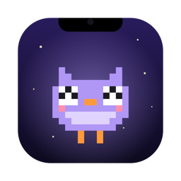

<p align="center">
  
</p>

<h1 align="center">Hoo Notch</h1>

<p align="center">
  A glassy, playful Dynamic Island for your Mac's notch, with Hoo the pixel owl,
  live Claude Code updates and a toolbox of everyday tools.
</p>

<p align="center">
  <a href="https://github.com/Aryanpuri27/vorssaint-custom/releases/latest"><b>⬇︎ Download the latest DMG</b></a>
  ·
  <a href="#install">Install</a>
  ·
  <a href="#whats-inside">What's inside</a>
  ·
  <a href="LICENSE">GPL-3.0</a>
</p>

---

Hoo Notch is a personal fork of the open-source Mac utility
[Vorssaint](https://github.com/vorssaint/vorssaint-utils). Everything Vorssaint does
is still here. On top of it, the notch is redesigned and gains a companion,
Claude Code integration and new tools.

> Hoo Notch is an unofficial build. It is not made, signed or endorsed by the
> Vorssaint maintainer. Please report Hoo Notch problems here, not upstream.

## Install

**You need:** a Mac with Apple Silicon (M1 or newer) running macOS 14 Sonoma or later.

1. Download **`Hoo-Notch-x.y.z.dmg`** from the [latest release](https://github.com/Aryanpuri27/vorssaint-custom/releases/latest).
2. Open it and drag **Hoo Notch** into **Applications**.
3. Open Hoo Notch from Applications. The first launch is blocked, because the app
   isn't notarized by Apple (that needs a paid developer account):
   - macOS shows *"Apple could not verify Hoo Notch…"*. Click **Done**.
   - Open **System Settings → Privacy & Security**, scroll down and click
     **Open Anyway** next to Hoo Notch, then confirm.

   Or run this once in Terminal instead:

   ```sh
   xattr -dr com.apple.quarantine "/Applications/Hoo Notch.app"
   ```
4. Hoo Notch lives in the menu bar. Grant only the permissions for the features you
   turn on; it asks when needed ([what each one is for](docs/PERMISSIONS.md)).

**Updating:** when a new release is out, *Check for Updates* opens this page.
Download the new DMG and replace the app.

## What's inside

### A redesigned notch
- **Frost glass** island that grows from the camera notch, with spring animations.
- **Swipe Stack music player:** swipe between now playing, up next and controls;
  scroll over the notch to change volume.
- Notifications, timers and live activities stack neatly. Quick actions live in one
  dock menu instead of floating around the notch.
- **Apple-style pages and app icons** throughout, plus Control Center toggles and
  sliders.

### Hoo, the pixel owl
- Hoo lives in the notch and reacts to what you do: music, calls, focus, Claude
  finishing a task, late nights.
- Every so often Hoo comes out of the notch for a show: fly-bys, dancing, juggling,
  magic, skating, stargazing or a nap.
- Outfits and accessories, a mood that follows your day, and two mini games:
  **Fireflies** and **Hoot!**. Poke Hoo to say hi.
- Quiet hours, and it pauses in Low Power Mode.

### Claude Code, live in the notch
- See what each Claude Code session is doing as it works.
- **Approve or deny** permission requests, **answer Claude's questions** and
  **approve plans** right from the notch.
- A card when a task finishes; a nudge if spending suddenly jumps; an evening recap.
- Start a **new Claude task** in any project folder from the notch, and browse your
  sessions.
- Usage and limits for **multiple Claude accounts** (separate `CLAUDE_CONFIG_DIR`s).
- Connect an account in **Settings → AI**. Hoo Notch adds its hooks to that
  account's `settings.json` and keeps a backup.

### Toolbox
Open the dock menu in the notch and choose **Toolbox**:

| Tool | What it does |
|---|---|
| **Terminal** | Run quick commands with zsh, with `cd`, history and Stop. **Ask Claude** explains the output. |
| **Docker** | Containers grouped by Compose project (works with OrbStack and Docker Desktop): start, stop, restart, CPU and memory, open ports, logs with **Ask Claude**. Hoo warns when a container crashes. |
| **GitHub** | Your open PRs and review requests with check status, through the `gh` CLI. Hoo tells you when checks pass or fail. |
| **Focus** | Pomodoro sessions (15, 25 or 50 min); Hoo cheers you through the breaks. |
| **Reminders** | Today's and overdue reminders; tick them off. |
| **Weather & clocks** | Current weather and a 4-day forecast ([Open-Meteo](https://open-meteo.com), no account needed) plus world clocks. |
| **QR codes** | Make a QR code from what you copied, or scan one anywhere on screen. |
| **Meetings** | Two minutes before a calendar event with a Meet, Zoom, Teams, Webex or FaceTime link, a **Join** card drops out of the notch. |

### Plus everything from Vorssaint
Per-app volume, window snapping, clipboard history, screenshots and recording,
app uninstaller, battery and fan control, and much more. See the
[Vorssaint README](https://github.com/vorssaint/vorssaint-utils#readme) for the full list.

Two things work differently in Hoo Notch: **fan control** needs a Developer ID
signature, so it's unavailable here, and updates come from this repository, not
Vorssaint's.

## Optional tools

Some features use command-line tools if you have them:
[Claude Code](https://claude.com/claude-code) for the Claude features,
[`gh`](https://cli.github.com) (signed in with `gh auth login`) for GitHub, and
`docker` ([OrbStack](https://orbstack.dev) or Docker Desktop) for Docker.

## Build it yourself

Xcode Command Line Tools are enough (`xcode-select --install`).

```sh
git clone https://github.com/Aryanpuri27/vorssaint-custom.git
cd vorssaint-custom
./build.sh --dev --install   # "Hoo Notch (Developer)" in /Applications
./build.sh --dev --test      # run the test suite
./build.sh && Tools/make-dmg.sh   # release app + dist/Hoo-Notch-<version>.dmg
```

`Tools/notchctl` drives the real notch for end-to-end checks (screenshots, clicks
by accessibility label); see [its README](Tools/notchctl/README.md).
`Tools/sync-upstream.sh` merges the latest Vorssaint changes.

## Privacy

Like Vorssaint, Hoo Notch has no account, ads or analytics. The new features talk
only to services you use: Open-Meteo for weather, GitHub through your own `gh`
login, and Claude Code on your Mac. The Claude hooks listen on `127.0.0.1` only,
with a per-install token. More in [docs/PRIVACY.md](docs/PRIVACY.md).

## Credits & license

Built on [Vorssaint](https://github.com/vorssaint/vorssaint-utils) by the Vorssaint
maintainer and contributors. Thank you! The Vorssaint name and logo belong to its
maintainer ([TRADEMARKS.md](TRADEMARKS.md)), which is why this fork has its own name,
icon and bundle id.

[GPL 3.0 or later](LICENSE), like the original.
